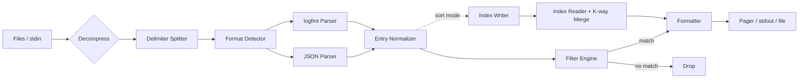

# Technical Design Document — `logcli`

**Status:** Draft v0.1
**Related:** [PRD.md](PRD.md) · [CLI_SPEC.md](CLI_SPEC.md) · [PARSING_SPEC.md](PARSING_SPEC.md) · [QUERY_SPEC.md](QUERY_SPEC.md) · [CONFIG.md](CONFIG.md)
**ADRs:** [0001 Rust](adr/0001-use-rust.md) · [0002 Streaming](adr/0002-streaming-architecture.md) · [0003 Indexing](adr/0003-index-for-sort.md) · [0004 Themes](adr/0004-theme-system.md)

---

## 1. Overview

`logcli` is a streaming pipeline: **input → decompress → split → parse → filter → format → output**. Sorting is a separate merge phase backed by an on-disk index. The design prioritizes:

1. **Zero-copy where possible** — parsed fields borrow from the input buffer.
2. **Bounded memory** — never hold a full file; sort uses an index and streaming merge.
3. **Parallel parsing** — files and chunks are independent until ordering matters.
4. **Deterministic output** — same input and flags produce byte-identical output.

---

## 2. Architecture



### Module map

| Module | Responsibility | Key types |
|---|---|---|
| `cli` | Flag parsing, help, completions | `Args` |
| `config` | File/env/flag merge | `Config` |
| `input` | File discovery, decompression, delimiter splitting | `Source`, `EntryReader` |
| `parser` | Format detection and extraction | `Parser`, `RawEntry` |
| `model` | Normalized entry model | `Entry`, `Level`, `Value` |
| `filter` | Level/time/field/query evaluation | `Filter`, `Expr` |
| `output` | Formatting, themes, pager | `Formatter`, `Theme`, `Pager` |
| `index` | Sort index write/read/merge | `IndexWriter`, `IndexReader` |
| `app` | Pipeline wiring, ordering, error policy | `App`, `RunStats` |
| `error` | Error types and exit codes | `Error`, `ExitCode` |

---

## 3. Data Model

```rust
/// A normalized log entry. Fields borrow from the input buffer when possible.
pub struct Entry<'a> {
    pub source: SourceId,          // index into source table
    pub line: u64,                 // 1-based line number
    pub timestamp: Option<DateTime<Utc>>,
    pub level: Option<Level>,
    pub message: Option<Cow<'a, str>>,
    pub logger: Option<Cow<'a, str>>,
    pub caller: Option<Cow<'a, str>>,
    pub fields: FieldMap<'a>,      // ordered, preserves input order for display
    pub original: &'a [u8],        // raw bytes for `--raw`
    pub parse_status: ParseStatus,
}

pub enum Level { Trace, Debug, Info, Warn, Error, Fatal, Panic, Other(u8) }

pub enum Value<'a> {
    Null,
    Bool(bool),
    Number(f64),                   // preserves integer-ness via raw text
    String(Cow<'a, str>),
    Array(Vec<Value<'a>>),
    Object(Vec<(Cow<'a, str>, Value<'a>)>),
}

pub struct FieldMap<'a> { /* small-vec + lookup index */ }
```

Design notes:
- `original` is retained only during processing; in sort mode raw bytes are written to the index instead of held.
- Values keep insertion order; JSON object order is preserved for display fidelity.
- Numbers retain their raw textual form for lossless output (`--raw-fields` and no rounding).

---

## 4. Pipeline Stages

### 4.1 Input
- Sources are opened lazily, in order, unless `--sort`.
- Compression detected by magic bytes (`1f 8b` gzip, `28 b5 2f fd` zstd, `42 5a 68` bzip2, `fd 37 7a 58 5a 00` xz), not extension.
- Reader stack: `File → BufReader(256 KiB) → Decompressor → DelimiterSplitter`.
- `DelimiterSplitter` handles LF/CRLF/CR/NUL and enforces `--max-entry-size` without allocating unbounded buffers.
- A line is yielded as `&[u8]`; UTF-8 lossy conversion happens only when fields are displayed.

### 4.2 Parsing
- Detection is per-line with a per-source memo: sniff first non-whitespace byte (`{` → JSON) and confirm with a cheap scan; fall back to logfmt when `key=` is present; otherwise plain-text entry.
- JSON uses `serde_json` into a borrowed `Value`-like representation; unknown shapes are preserved.
- logfmt is a hand-written single-pass parser (quotes, escaped `\"`, `\n`, `\\`, bare keys).
- `--allow-prefix` skips a balanced-brace-aware prefix scan to the first `{` that starts a valid object. Bounded by `--max-entry-size`.
- Parser errors produce `ParseStatus::Invalid` with a reason; the entry is skipped unless `--strict`.
- See [PARSING_SPEC.md](PARSING_SPEC.md) for field-mapping rules.

### 4.3 Normalization
- Timestamp: first present of configured keys, then heuristic keys (`ts`, `time`, `timestamp`, `@timestamp`, `date`).
- Level: configured keys, then `level`, `lvl`, `severity`, `severity_text`; normalized case-insensitively; numeric mapping documented in PARSING_SPEC.
- Message: `message`, `msg`, `log`, `@message`, configurable.
- Logger/caller: `logger`, `source`, `caller`, `file`.
- Reserved names (`level`, `message`, `caller`, `logger`) stay addressable via `.` prefix in queries.

### 4.4 Filter Engine
- Filters compile once into an AST and are evaluated per entry.
- Order of evaluation is cost-based: level → time → cheap field equality → substring → regex.
- Short-circuit boolean evaluation.
- Regexes are compiled at startup; invalid regex → exit `1`.
- Query ASTs are `Send + Sync` and shared read-only across workers.

### 4.5 Formatting
- Default layout: `TIME LEVEL LOGGER [CALLER] MESSAGE key=value ...`
- Column widths: fixed for time/level; message is last-field-flow layout to avoid full buffering.
- Expansion modes control whether message/fields with newlines are printed inline (escaped `\n`), or expanded to indented blocks.
- `--flatten always` renders nested objects as dotted keys in insertion order.
- `--hide`/`--flatten` operate on the display tree, never mutate the normalized entry.
- Color application is token-based (theme roles), so themes cannot break layout width calculations (ANSI stripped when measuring).

### 4.6 Output
- Writer selection: `stdout` (with optional pager child process) or file.
- Pager: spawn `$LOGCLI_PAGER` / `$PAGER` / `less -R` via `sh -c` on Unix and `cmd /C` on Windows; wait and forward exit status; never spawn when not a TTY.
- Broken pipe is detected from `EPIPE`/`ERROR_BROKEN_PIPE` and mapped to exit `3`.
- A single `BufWriter` (64 KiB) is shared; flushing policy depends on TTY.

---

## 5. Sorting & Indexing

Goal: chronological merge across many files without loading them into memory.

### 5.1 Index format (versioned)

```
Header: magic "LGCI" | version u16 | flags u16 | entry_count u64 | source_table_len u32
Source table: path, size, mtime_ns, offset_count
Entries (record-oriented, delta + varint encoded):
  timestamp_delta (i64, zigzag varint, sorted non-decreasing)
  source_id (varint)
  byte_offset (varint)
  byte_length (varint)
  level (u8)
Index footer: crc32c of entries section
```

- One index per source file, stored as `<hash>.lgci` in `--index-dir`.
- Validation checks magic, version, file size, mtime, and CRC. On mismatch, reindex.
- `--dump-index` prints header, entry count, and first/last timestamps.

### 5.2 Build path
1. Scan each file (parallel) recording `(timestamp, offset, len, level)`; skip unparseable timestamps but count them.
2. Write index atomically (`.tmp` + rename).
3. Incremental update: if file grew and prefix hash matches, append new entries; unchanged blocks are skipped by block-level checksums (block = 1 MiB).

### 5.3 Merge path
- K-way merge over index readers (binary heap keyed by timestamp, then source id, then offset).
- For each selected entry, seek to `offset`, read `len` bytes, parse *only that entry* (lazy), apply filters, format.
- Filters on level can be applied from the index without reading the entry (fast path). Time filters are applied on index keys.
- Memory: O(k) for k sources plus buffer per reader.

### 5.4 Follow mode
- Track file growth via metadata polling (`notify` crate optional; poll interval from `--sync-interval-ms`).
- Maintain a small in-memory buffer per source; emit when the entry timestamp is older than `now - sync_interval` or when no source has pending entries.
- `--tail N` preloads the last N raw lines per file (reverse scan of index or tail scan).

---

## 6. Concurrency Model

- **Non-sorted mode:** single reader thread per source (files processed sequentially by default to preserve output order), parsing can be parallelized internally per chunk when `--concurrency > 1` and order is restored via sequence numbers. Start simple: sequential parse, parallel only for index building.
- **Sort/index build:** Rayon work-stealing over byte ranges for parse, then ordered reduce into index writer.
- **Follow mode:** one poller task; merge happens on the main thread.
- Writer is single-threaded; no locks on the hot path.

Rule: **parallelism must never change output.** Ordering keys are `(source order, offset)` in normal mode and `(timestamp, source order, offset)` in sort mode.

---

## 7. Performance Budget

| Stage | Budget (2.3 GiB, 6M lines) |
|---|---|
| Read + decompress (gz) | ~0.4 s |
| Split + detect + parse | ~0.8 s |
| Normalize | ~0.15 s |
| Filter (typical) | ~0.1 s |
| Format + write to NUL | ~0.3 s |
| **Total (uncompressed)** | **≤ 1.2 s** |
| **Total (gzip)** | **≤ 2.5 s** |

Techniques:
- Borrowed strings; avoid `String` allocation for fields that are not displayed.
- Reused per-thread buffers; > 4 KiB stack buffers avoided.
- `itoa`/`ryu` for number formatting; no `format!` in the hot loop where avoidable.
- Batch writes through a 64 KiB buffer.
- `criterion` benchmarks committed; CI fails on > 10% regression vs baseline.

---

## 8. Error Handling

```rust
pub enum Error {
    Usage { message: String, tip: Option<String> },   // exit 1
    Io { path: Option<PathBuf>, source: io::Error },  // exit 2
    Query { column: usize, message: String },         // exit 1
    Config { path: Option<PathBuf>, message: String },// exit 1
    BrokenPipe,                                       // exit 3
    Interrupted,                                      // exit 130
}
```

- `main` maps errors to exit codes; only `--verbose` prints backtraces.
- Panics are caught at the top level, reported tersely, and exit `2` (should never happen; fuzz-tested).
- Per-line parse failures are data errors, not `Error`; they surface through `RunStats`.

---

## 9. Configuration Model

- Precedence: built-in defaults → system config → user config → `LOGCLI_CONFIG` files → CLI flags.
- Config parsed into the same `Config` struct as flags; merge is field-wise with "explicitly set" tracking.
- Theme resolution: `@base` → selected theme → overlays.
- See [CONFIG.md](CONFIG.md) for schema and locations.

---

## 10. Testing Strategy (summary)

| Level | Tool | Scope |
|---|---|---|
| Unit | `cargo test` | parsers, filters, query AST, level/time parsing |
| Property | `proptest` | parser never panics; format→parse invariants |
| Fuzz | `cargo fuzz` | JSON/logfmt/prefix/query parsers |
| Integration | `assert_cmd` + `predicates` | every CLI_SPEC example |
| Golden | `insta` | formatted output snapshots, theme output |
| Performance | `criterion` + `hyperfine` | throughput, RSS, startup |

Full details: [TEST_PLAN.md](TEST_PLAN.md).

---

## 11. Project Layout

```
logcli/
├── Cargo.toml
├── src/
│   ├── main.rs
│   ├── cli.rs
│   ├── config.rs
│   ├── app.rs
│   ├── error.rs
│   ├── model/{mod.rs,entry.rs,level.rs,value.rs}
│   ├── input/{mod.rs,source.rs,decompress.rs,splitter.rs}
│   ├── parser/{mod.rs,json.rs,logfmt.rs,detect.rs,normalize.rs}
│   ├── filter/{mod.rs,level.rs,time.rs,field.rs,query/{ast.rs,parse.rs,eval.rs}}
│   ├── index/{mod.rs,format.rs,writer.rs,reader.rs,merge.rs}
│   └── output/{mod.rs,format.rs,theme.rs,pager.rs}
├── tests/
│   ├── cli.rs
│   ├── parsing.rs
│   ├── filtering.rs
│   ├── sorting.rs
│   └── fixtures/
├── benches/
├── docs/
└── themes/
```

---

## 12. Dependencies (proposed)

| Crate | Purpose | Notes |
|---|---|---|
| `clap` (derive) | CLI | Matches hl's ergonomics |
| `serde`, `serde_json` | JSON | `serde_json::Value` or custom borrowed parser |
| `chrono` / `jiff` | Time | Evaluate `jiff` for timezone data quality |
| `flate2`, `zstd`, `bzip2`, `xz2` | Decompression | Feature-gated per format |
| `regex` | Regex filters | Compile once |
| `rayon` | Parallel index build | Optional, feature-gated |
| `nu-ansi-term` | Colors | Or custom ANSI writer |
| `memchr` | Fast splitting | Hot path |
| `itoa`, `ryu` | Number formatting | Hot path |
| `dirs` | Config/cache paths | Cross-platform |
| `thiserror` | Error types | Dev ergonomics |
| `assert_cmd`, `predicates`, `insta`, `criterion`, `proptest` | Dev | Testing |

---

## 13. Open Technical Questions

1. `serde_json` allocation cost vs a custom borrowed JSON parser — benchmark before committing.
2. Whether `--sort` should also support a pure in-memory path for small inputs (< 50 MB) to avoid disk I/O.
3. Index invalidation strategy when `mtime` is unreliable (network filesystems).
4. Whether output formatting can be parallelized by chunk when sorting is enabled.
5. Windows ANSI/pager detection details (ConPTY, Windows Terminal, legacy console).
